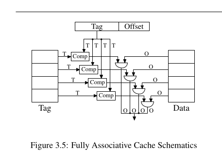
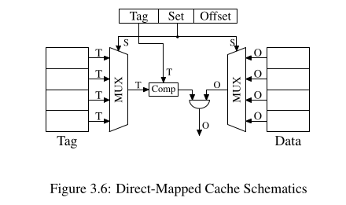
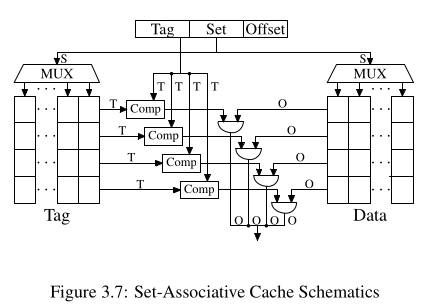

# Section 3.3.1 — Associativity — Quiz

**1. Why is a fully associative cache (Figure 3.5) impractical for anything bigger than something like a TLB? What specifically fails to scale as the cache grows?**
Answer: too many comparators are not feasible and iterative is just way too slow.
Grading: correct. Both real costs from the text: too many comparators is a feasibility/area problem, and the "shortcut" of reusing fewer comparators iteratively is too slow — same problem as iterative anything, it just takes too long.

**2. In the three schematics (3.5 fully associative, 3.6 direct-mapped, 3.7 set-associative), what's the role of the `MUX` boxes, and why does Figure 3.6 (direct-mapped) only need exactly one `Comp`?**
Answer: so each set has just one data hence 3.6 just needs one comp. Mux are used to select which buckets of tag to compare.
Grading: correct. Direct-mapped has exactly one way per set, so one `Comp` suffices once the row is picked; `MUX` selects which stored row (tag and data) to pull out using the Set bits.

**3. For a set-associative cache, what increases the number of comparators needed (the "rows"), and what instead increases the `MUX` size (the "columns")? Why is one of these considered cheaper to scale than the other?**
Answer: associativity, set number. (asked for the "why cheaper" part to be explained)
Grading: correct on the identification. Why one is cheaper: growing the number of sets (columns) only requires a bigger `MUX`, and multiplexer cost grows as O(log N) — sub-linear, cheap. Growing associativity (rows) means duplicating a full comparator per additional way, and comparators are themselves large, complex, speed-critical circuits (per Q1) — so each added way costs a full linear increment of expensive hardware. Log-growth vs. linear-growth of expensive components is why set count is the cheap dimension and associativity is the expensive one.

**4. From Table 3.1 / Figure 3.8 (the gcc benchmark data): going from direct-mapped to 2-way set-associative at a fixed cache size showed a big improvement in misses, but going from 8-way to higher associativity showed little further benefit. What's the general pattern described for how associativity's benefit scales?**
Answer: they diminish after 8. The importance of associativity is to avoid collision and beyond 8 there are not meaningful collisions to have significant impact.
Grading: correct, with one precision add: the text specifically scopes this to a single-threaded workload — which sets up Q5, since that caveat is exactly what changes under multi-core/hyper-threaded sharing.

**5. Why does the text say increasing associativity above 8 becomes more important specifically with hyper-threading and multi-core processors sharing a cache, even though it matters less for single-threaded workloads?**
Answer: more programs in parallel => more pressure on the cache => we need better collision avoidance => increasing associativity will be better.
Grading: correct, and this is the key insight. Multiple threads/cores sharing one cache effectively halves (or quarters, for quad-core) the associativity each one experiences in practice, so nominal associativity needs to grow as core counts grow to maintain the same effective per-thread associativity.

**6. In the gcc example, the working set peaked at 5.6MB, yet a 16MB cache (2-way) still beat a 16MB direct-mapped cache. If 16MB is already ~3x the working set, why would there still be measurable conflicts at all?**
Answer: performance advantages of comparing in parallel will kick in.
Grading: incorrect, corrected. The real reason: the working set's memory isn't contiguous — it's scattered across the address space. Set-index collisions depend on which set an address's bits map to, not on total available capacity. So even with 3x the capacity needed, some scattered pieces can still map to the same set while other sets sit empty. More capacity doesn't fix an uneven distribution across sets — only more associativity (more ways per set) or a cache large enough to make collisions statistically negligible can.

**7. What's the practical advice given for someone choosing how much cache to pay for in a new machine, and what's the important caveat about treating a measured working-set size as a permanent number?**
Answer: idk.
Grading: answer provided. Measure your actual program's working set size before choosing how much cache to pay for — that number tells you whether a given cache size is well-matched or wasteful. Caveat: working sets grow over time as software evolves, so a cache comfortably oversized for today's working set may not be oversized for tomorrow's larger version of the same program.
